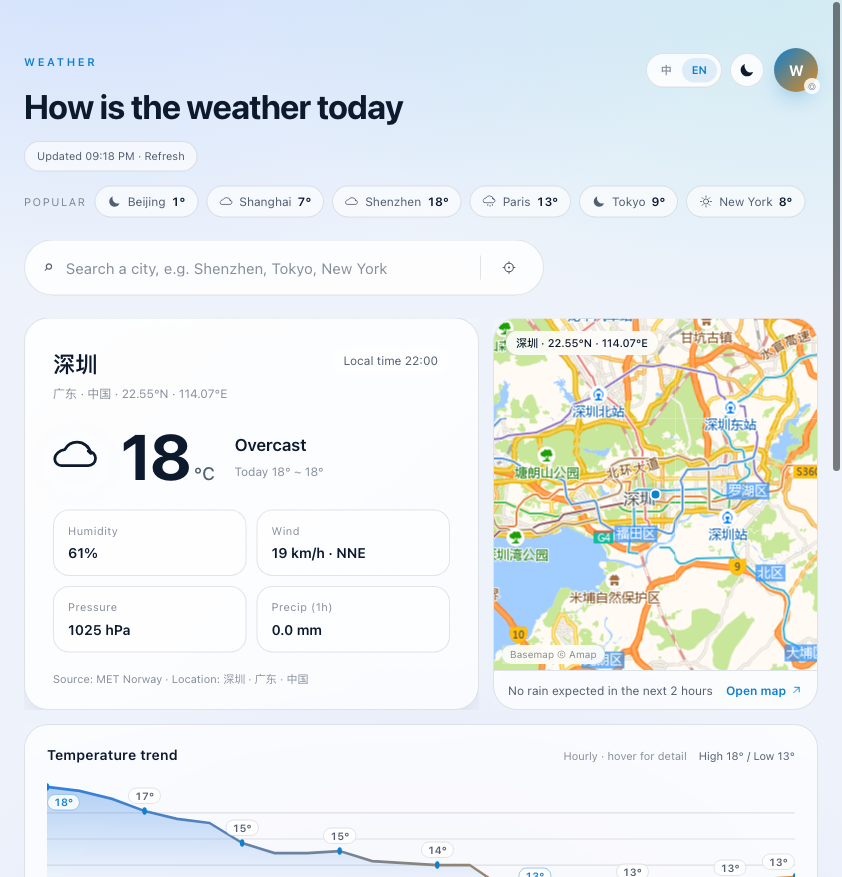

# 天气应用 · Weather App

用 Next.js 14 + React 18 + TypeScript + Tailwind CSS 实现的城市天气应用：搜索地点、当前天气、未来 24 小时与未来 7 天预报，加载态 / 错误态 / 空态齐全。

**已经做完的**：地点搜索（防抖 + 竞态取消）｜当前天气（温度/湿度/风速/气压/降水）｜未来 24 小时逐时｜未来 7 天高低温区间条 + 降水概率外的降水mm｜浏览器定位 + 逆地理编码｜温度趋势折线（悬停看细节）｜深色/浅色换肤｜中英切换｜默认城市记忆｜热门城市胶囊（实时温度）｜位置地图（真实瓦片 + 境外降级）｜Loading / Error / Empty 三态｜统一响应信封 + 真实 HTTP 状态码。

**环境要求**：Node ≥ 18（开发用 22 更稳）、Yarn 4（`corepack enable` 即可）。无需 API Key、无需 `.env`。

    




---

## 快速开始

```bash
yarn install
yarn dev            # http://localhost:3000
```

其他命令：`yarn lint` / `yarn format` / `yarn typecheck` / `yarn build` / `yarn start`。

`yarn start` 不是 `next start`：项目开了 `output: 'standalone'`，产物是「自带最小 node_modules 的独立服务」，`next start` 找不到 vendor-chunks 会直接 500（Next 官方也说明两者不兼容）。所以 `start` 走 `scripts/start-standalone.mjs`：先把 `public` 与 `.next/static` 同步进 `.next/standalone`（和 Dockerfile 运行层做的是同一件事），再起 `standalone/server.js`，本地预览与镜像行为一致。

> 无需任何 API Key 或 `.env`，开箱即用。
>
> 包管理器为 Yarn 4（`.yarnrc.yml` 固定 `nodeLinker: node-modules`，即常规 `node_modules` 布局；registry 固定到 npm 官方源，保证本机与容器装到同一批包）。
> 质量门四道：`yarn lint`（ESLint + next/core-web-vitals，零告警）、`yarn format:check`（Prettier）、`yarn typecheck`（tsc）、`yarn build`。

### 用 Docker 起

```bash
docker build -t weather-app .
docker run -p 3123:3000 weather-app
# 或
docker compose up --build
```

镜像为三阶段构建（deps → builder → runner），运行层只带 Next `standalone` 产物 + 非 root 用户，本机实测 **269MB**，自带 `HEALTHCHECK`。

> Docker Hub 元数据在部分网络下会超时，基础镜像已做成 `ARG`：`docker build --build-arg NODE_IMAGE=<你的镜像站>/library/node:22-alpine .`

---

## 一张图看懂数据流

```
浏览器
  │  ① 用户操作（搜索 / 点击胶囊 / 点定位）
  ▼
app/(weather)/page.tsx ──► stores/use-weather-store（状态机 + 单飞 + 10min 缓存）
  │                                   │
  │                                   ▼
  │                        services/weather-service ──► services/api-client（超时 / 错误归一化）
  │                                   │
  │ ② 只请求自家 /api/*               ▼
  │                        app/api/{geocode,weather,location,overview}/route.ts
  │                                   │
  │                                   ▼
  │                        server/{envelope,weather/*}（适配器 + 10min 进程内缓存）
  │                                   │
  │ ③ 服务端代理，避免 CORS/UA 问题     ▼
  └──────────────────────── 上游：MET Norway 预报 / Open-Meteo 地理编码 / 逆地理 / 高德瓦片
```

- 客户端只认 `/api/*` 与统一信封，**从不直连上游**（UA 要求、CORS、缓存策略都收在服务端一处）。
- `stores` 只负责状态与请求生命周期，`services` 只管取数，`lib` 全是纯函数——任一层可单独替换。

---

## 目录结构

按「职责」分层，且命名、分层顺序对齐生产级项目的通行做法（config → services → stores → server → types → lib → components）：

```
tailwind.config.ts           # 设计令牌（色板/圆角/字体/动效），组件只消费语义化 token
Dockerfile                   # 三阶段构建，运行层只带 next standalone 产物
docker-compose.yml           # 一条命令起服务（含 healthcheck）
.eslintrc.json               # next/core-web-vitals + prettier 兼容层 + 少量自定规则（含 scripts 例外）
.prettierrc / .prettierignore
commitlint.config.mjs        # Conventional Commits 规范
.lintstagedrc.json           # 提交前只对暂存文件跑 eslint --fix + prettier
.husky/pre-commit            # lint-staged + typecheck
.husky/commit-msg            # commitlint 校验提交信息
public/assets/               # 静态资源根：svg/（图标源文件，大驼峰）、images/（位图）
scripts/build-assets.mjs     # 资源管线：扫目录 → 生成 SvgPor 类（会被 lint）
src/
├── app/                     # ← 路由层 + 业务模块（business module）
│   ├── (weather)/           # 天气业务模块：路由组，不影响 URL（页面仍在 /）
│   │   ├── page.tsx         #   只做编排：store 状态 → 组件
│   │   └── components/      #   只服务本模块的业务组件
│   │       ├── search-bar.tsx
│   │       ├── current-weather-card.tsx
│   │       ├── hourly-strip.tsx
│   │       ├── temperature-trend.tsx   # SVG 手绘温度趋势折线
│   │       ├── popular-cities.tsx      # 头部推荐城市胶囊（一次批量拿温度）
│   │       ├── location-map.tsx        # 真实瓦片 + 中心标记 + 未来两小时文案
│   │       └── forecast-list.tsx
│   ├── layout.tsx           # 全局：字体 / 主题引导脚本 / i18n 注入
│   ├── globals.css
│   ├── icon.svg
│   └── api/                 # Route Handler（不是"路由层混进业务"，见「关键设计 0」）
│       ├── geocode/route.ts    # GET /api/geocode?q=&lang=   地点搜索代理
│       ├── location/route.ts   # GET /api/location?lat=&lon= 逆地理编码（定位功能）
│       ├── overview/route.ts   # GET /api/overview?cities=  推荐城市批量当前温度
│       └── weather/route.ts    # GET /api/weather?...        天气查询（入参校验 + 10 分钟缓存）
├── components/              # ← 公共组件（跨模块复用，与天气业务无关）
│   ├── app-controls.tsx     # 主题 / 语言切换
│   ├── brand-mark.tsx       # logo 按钮：点击即定位到我的位置
│   └── state-views.tsx      # EmptyState / LoadingState / ErrorState
├── assets/
│   ├── svg/                 # 图标源文件（大驼峰命名，如 IconMoon.svg）
│   ├── icons.ts             # ← 生成：SvgPor 类 + svgIcon()，勿手改
│   ├── images.ts            # ← 生成：IMAGES 清单（含像素尺寸），勿手改
│   └── index.ts             # ← 生成：资源总出口（SvgPor / IMAGES / svgIcon），勿手改
├── config/                  # 配置与常量，环境差异集中在这里
│   ├── api.ts               # API_ENDPOINTS + UPSTREAM（上游地址/超时/UA/结果条数）
│   ├── cities.ts            # 热门城市推荐位 + 默认城市（按语言）
│   ├── map.ts               # 瓦片源 / 缩放级别 / 外部地图深链
│   ├── i18n.ts              # zh/en 词典 + 错误码映射 + 日期 locale 映射
│   └── env.ts               # 环境常量：/api 前缀、请求超时
├── services/                # 客户端数据访问层（只跟自家 /api 打交道）
│   ├── api-client.ts        # 统一请求客户端：拼 query、超时、非 2xx 归一化
│   ├── api-client-error.ts  # 带 status 的客户端错误类型
│   ├── api-envelope.ts      # 响应信封解包 + 业务失败判定
│   └── weather-service.ts   # 业务方法：searchLocations / getSnapshot / reverseGeocode
├── stores/                  # 全局状态
│   ├── use-weather-store.ts     # Zustand：状态机 + 单飞 + 客户端缓存
│   └── use-preference-store.ts  # Zustand + persist：主题 / 语言偏好
├── server/                  # 仅在 Route Handler 中运行的代码（不会进客户端 bundle）
│   ├── envelope.ts          # 统一响应信封 ok() / fail()
│   ├── weather-error.ts     # 服务端错误类型 + 未知错误归一化
│   └── weather/
│       ├── geocoding.ts     # Open-Meteo Geocoding 适配器（支持 zh/en）
│       ├── reverse.ts       # 逆地理编码适配器（坐标 → 地名）
│       └── metno.ts         # MET Norway 预报适配器（日聚合 + WMO 映射 + 时区）
├── types/
│   ├── weather.ts           # 领域模型（UI / 服务端共用）
│   └── svg.d.ts             # *.svg 作为 React 组件的模块声明
├── lib/                     # 无状态纯函数工具
│   ├── format.ts            # 时间/风向/坐标/地名/人口格式化
│   ├── time.ts              # UTC → 地点当地时间（Intl，含夏令时）
│   ├── weather-codes.ts     # WMO code → 中英文案/图标
│   └── cn.ts                # 条件 className 拼接（不引 clsx）
└── hooks/
    ├── use-location-search.ts  # 输入 → ahooks 防抖 → 请求 → 结果（含竞态取消）
    ├── use-geolocation.ts      # navigator.geolocation + 逆地理编码 + 超时看门狗
    └── use-i18n.ts             # 取词器 t(key, vars)
```

**头部信息架构**：标题左侧、右上角是「语言/主题 + logo 定位」，下面是热门城市胶囊（`config/cities.ts`，按语言各一套），点一下直接出结果，省掉「先想关键词再打字」。胶囊上直接显示该城市**当前温度与昼夜图标**（一次 `GET /api/overview` 批量取，不是 6 次请求）。

**业务组件 vs 公共组件**：判据只有一条——**只有这个业务模块会用，就放在模块目录里**。

- `app/(weather)/components/`：只服务天气页的组件（天气卡、逐小时、趋势、预报、地图、搜索框、热门城市胶囊）。删掉这个模块，这些文件一起删，不会影响别处。
- `components/`：跨模块复用的公共组件（品牌位、主题/语言控件、Idle/Loading/Error 状态视图）。它们不认识「天气」这个概念，只认识 props。

`(weather)` 是 **Route Group**：括号目录不参与 URL 生成，页面依旧在 `/`，只是把「一个业务模块」在文件系统里圈出来。以后加第二个模块（比如 `(aqi)`、`(settings)`），各带各的 `components/`，公共的再往上提——这才是不用等重构就能扩展的结构。

**依赖方向是单向的**：`app → components → hooks → stores → services → types`，`server` 只被 `app/api` 引用。任何一层都能被单独替换，不存在循环依赖，也不存在"组件里偷偷 fetch 上游"。

**样式约定**：不用 CSS Modules、不写组件级样式文件，全部 Tailwind 类名；色板 / 圆角 / 动效等 token 定义在 `tailwind.config.ts`，组件只写 `bg-surface`、`text-ink-muted` 这类语义类名，换主题只改一处。

**备注约定（注释怎么写）**：每个模块顶部一段块注释，写「这个模块负责什么」+「为什么这么选」；关键分支的备注解释**原因**（为什么不是另一种写法），而不是复述代码在干什么。踩过的坑会直接标注在原处，例如 `overview` 路由的 `no-store`、SVG 折线的数值标注层、状态机里单飞的取消逻辑。

---

## 关键设计

### 0. 为什么 `app/` 里既有页面又有 API

这是 Next.js App Router 的**约定目录**，`app/` 下的每个文件夹就是一个 URL 段，具体渲染成页面还是接口，由文件名决定：

```
src/app/
├── (weather)/page.tsx    → 渲染 GET /            （页面，路由组不产生 URL 段）
├── layout.tsx            → 所有页面的外壳
└── api/
    ├── geocode/route.ts  → 处理 GET /api/geocode （接口）
    └── weather/route.ts  → 处理 GET /api/weather （接口）
```

- `route.ts` 是 Route Handler 的保留文件名（和 `page.tsx`、`layout.tsx` 同级约定）；写成 `api/weather/page.tsx` 就变成"一个页面"，而不是接口。
- 所以 `/api/*` 放在 `app/` 下**不是放错**，反而是官方推荐位置：路由、接口共用一套 URL 结构，部署时也不需要额外服务。
- 「页面职责」并没有被稀释：`app/(weather)/page.tsx` 只做编排（store 状态 → 组件），业务组件在 `app/(weather)/components/`，公共组件在 `components/`，数据访问在 `server/` + `services/`。
- 如果以后服务端逻辑变重（多服务、独立部署、需要复用给别的客户端），才把它抽成独立 Node 服务或 `server/` 独立进程——那属于超出本题范围的取舍。

> 老项目里的 `pages/api/*` 是 Pages Router 的写法，和 App Router 不混用；本项目从头就是 App Router。

### 1. 状态管理：Zustand 单 store + 可辨识联合

```ts
type WeatherState =
  | { status: 'idle' }
  | { status: 'loading'; location: GeoLocation }
  | { status: 'success'; location: GeoLocation; data: WeatherSnapshot }
  | { status: 'error'; location: GeoLocation; errorStatus: number };
```

- **非法状态无法构造**：不会出现 `isLoading` 与 `data` 同时为真、或 `error` 与 `success` 并存。
- **副作用句柄放在 store 外**：`AbortController` 与缓存 Map 是模块级变量，不进入 React 渲染依赖，避免把"请求句柄"也纳入状态。
- **单飞**：每次新请求先 `abort()` 上一笔，慢请求不会覆盖新结果；主动取消的 `AbortError` 静默丢弃，不误报成网络错误。
- **客户端 10 分钟缓存**：同城市来回切换直接命中内存缓存，「刷新」按钮 `force` 绕过。

> 仅一个页面消费状态，理论上不需要状态库；这里用 Zustand 是为了把「天气状态机 + 请求生命周期」从页面组件里拿出来，页面只剩"状态 → 组件"的映射，也便于未来扩展收藏/多城市对比。

### 2. 统一响应信封（客户端与服务端同一契约）

服务端所有 `/api/*` 都返回：

```json
{ "code": 200, "success": true, "message": "ok", "timestamp": 1795082019645, "data": { ... } }
```

- `server/envelope.ts` 的 `ok()/fail()` 统一构造信封，**并用真实 HTTP 状态码**（400/404/429/502），不把错误伪装成 200——否则前端无法用状态码做重试/降级，日志与监控也失真。
- 客户端 `services/api-envelope.ts` 的 `unwrapApiData` 负责解包：HTTP 非 2xx 或 `success=false` 都转成 `ApiClientError(message, status)`，页面只处理一种错误类型。

### 3. 数据层：适配器模式 + 服务端代理

```
组件 → stores → services/weather-service → api-client → /api/* (Route Handler) → server/weather/* → 上游
```

1. **UI 与上游解耦**：`types/weather.ts` 定义领域模型，`server/weather/*` 把上游字段翻译成领域模型；换数据源只改一个适配器。
2. **密钥/合规留在服务端**：将来换 OpenWeatherMap、和风天气，Key 放环境变量即可；MET Norway 要求带可识别的 `User-Agent`（浏览器不允许自定义该头，必须服务端发）。
3. **缓存与降级有落点**：超时、状态码、聚合、缓存全在一处处理。

### 4. 错误处理：分类而非笼统


| 场景                 | 处理方式                     | 用户看到                            |
| -------------------- | ---------------------------- | ----------------------------------- |
| 客户端网络断开/超时  | `api-client` 捕获 fetch 异常 | 「网络连接失败，请检查网络后重试」  |
| 上游连接失败         | `AbortSignal.timeout` 8s     | 「天气服务连接失败，请稍后重试」    |
| 上游 429             | 显式分支                     | 「请求太频繁了，请稍后再试」        |
| 上游 5xx / 非 2xx    | 状态码判定                   | 「天气服务暂时不可用，请稍后重试」  |
| JSON 解析失败        | try/catch                    | 「天气数据解析失败，请重试」        |
| 无数据（远洋坐标等） | 序列为空                     | 「该地点暂无可用天气数据」          |
| 搜索无结果           | 正常业务分支，不抛错         | 「没有找到「xxx」，换个关键词试试」 |
| 用户主动取消         | `AbortError` 静默丢弃        | 无                                  |

### 5. 缓存策略（三层，各司其职）


| 层            | 位置                                   | 作用                                                   |
| ------------- | -------------------------------------- | ------------------------------------------------------ |
| 上游 fetch    | `next: { revalidate: 600 }`            | 同一进程内不反复打公共接口                             |
| Route Handler | 进程内 Map，10 分钟                    | 多用户共享同一坐标的结果（与上游 10 分钟更新频率对齐） |
| 客户端        | `stores/use-weather-store.ts`，10 分钟 | 同城市来回切换不重复请求；刷新可强制绕过               |

**⚠️ 缓存只存「天气数据」，不存「地点身份」**：天气缓存的 key 是 `lat|lon|tz`，而 `name / admin1 / country` 是同坐标可能不同写法（「深圳」vs「深圳市」）的展示信息。因此缓存命中时用本次请求参数重建 `location` 再返回，否则会出现"地名显示成上一次请求的空值"。这个坑在开发中实际踩到过，代码里留了注释。

另外 `/api/weather` 响应头是 `no-store`：**浏览器 HTTP 缓存会绕过服务端缓存、导致身份信息读到旧响应**，而服务端缓存已经承担了降流量职责，浏览器缓存没有必要。

---

### 6. 元件設計：展示與数据彻底分开

- **constraint 1：展示组件不碰数据。** `components/*` 里没有 `fetch`、没有 store 读取（除 `app-controls` 只读偏好开关），所有数据由 `page.tsx` 一次性注入 props；想换数据源、加缓存都不需要动组件。
- **constraint 2：一个组件只解一件事。** 天气卡、24 小时条、7 天列表、温度折线、地图、搜索框、头部胶囊彼此不嵌套，想调整顺序只是 page 里换行。
- **constraint 3：容器逻辑集中在 page + hooks。** 首屏引导、定位、语言重建地名、错误提示都在 `page.tsx`；输入防抖/竞态在 `hooks/use-location-search`，定位看门狗在 `hooks/use-geolocation`。
- **constraint 4：props 都是窄类型。** 传的是 `WeatherSnapshot` / `HourlyPoint[]` / `DailyForecast[]`，不是"整个 store"；组件因此可单独在 Storybook 或测试里喂假数据渲染。
- 命名统一 kebab-case（`current-weather-card.tsx`），与 React 生态默认的 PascalCase 文件不同，是为了对齐自家 Velora-web 的仓库约定；组件导出的仍是 PascalCase 组件名。

### 7. 可維護性：把"将来会变的东西"集中到一处


| 会变的东西            | 收斂在哪                                         | 换掉要改几个文件                      |
| --------------------- | ------------------------------------------------ | ------------------------------------- |
| 天气数据源            | `server/weather/metno.ts`                        | 1 个适配器（领域模型不变）            |
| 地理编码 / 逆地理编码 | `server/weather/geocoding.ts` / `reverse.ts`     | 各 1 个                               |
| 地图瓦片源            | `config/map.ts`                                  | 1 个                                  |
| 推荐城市、默认城市    | `config/cities.ts`                               | 1 个                                  |
| 文案 / 语言           | `config/i18n.ts` + `hooks/use-i18n`              | 1 个词典（`en` 漏 key 直接 tsc 报错） |
| 配色 / 圆角 / 动效    | `tailwind.config.ts` + `globals.css` 的 CSS 变量 | 1 处                                  |
| 接口地址 / 超时       | `config/api.ts` / `config/env.ts`                | 1 处                                  |

配套约束：全量 TypeScript、零 `: any`、`tsc --noEmit` 与 `next build` 每次改动都跑；除框架（next/react）外，第三方运行时依赖只有 `zustand` + `ahooks`（无 UI 库、无图表库、无 axios、无地图库）。

## 四项增强：定位 / 温度趋势 / 换肤 / 中英切换

### 1. 当前定位（Use my location）

入口有两个，都走同一套逻辑：**头部右上角的 logo（点一下即定位）** + 搜索框内的十字准星按钮。

链路：`navigator.geolocation` → `/api/location?lat&lon&tz&lang` → 地名 → 复用同一套天气查询。

- **只在用户点击时请求权限**，不自动弹窗；拒绝、不支持、超时都给出可翻译的明确文案，并保留手动搜索作为兜底。
- **精度选择**：`enableHighAccuracy: false`。天气只需要城市级精度，高精度会明显拖慢首响、增加耗电。
- **时区**：定位场景下浏览器 IANA 时区即为用户真实所在时区，随请求一起传给服务端，比让上游猜更准。
- **看门狗 12s**：某些环境（无头浏览器、系统拦截）既不触发 success 也不触发 error，没有它按钮会永远卡在"定位中"。
- 逆地理编码源：Nominatim / Open-Meteo（无接口）/ api-bigdatacloud.net 在主域名实测均不可达，最终选 `us1.api-bdc.net`，支持 zh/en。

### 2. 温度趋势（折线）

- **纯 SVG 手绘**，不引 recharts / echarts：只需要一条 24 点曲线 + 渐变面积，图表库会带来几十 KB 体积与额外的主题/响应式适配成本。
- 坐标映射是纯函数（min/max 自适应、视野固定 24 点），数据长度变化不需要改布局；每个数据点挂原生 `<title>`，悬停即可看到「时间 · 温度 · 天气」。
- 颜色走 `--chart-from` / `--chart-to` 令牌，深浅色自动切换。
- **数值标注**：每 3 小时一个刻度 + 最高/最低必定标注（极值用强调色描边）。SVG 用了 `preserveAspectRatio="none"`（曲线随宽度拉伸），所以数字不能放进 SVG——会被横向拉变形；改为 HTML 叠层按百分比定位，并对两端做水平内缩、贴顶时翻到点下方，相邻过近且数值重复时自动让位，保证不叠字。

### 3. 换肤（深色 / 浅色）

- 所有颜色改为 **CSS 变量**（`:root` 深色、`[data-theme='light']` 浅色），组件只写 `bg-surface`、`text-ink-muted` 这类语义类名 → **换肤零组件改动**，新增主题只需加一段变量覆盖。
- 偏好存 `localStorage`（Zustand `persist`），并在 `layout` 里内联一段脚本在 React 挂载前把 `data-theme` 写回 `<html>`，避免首屏闪白/闪黑。
- 踩坑：曾给 `body` 加 `transition: background-color/color`，结果浏览器标签页被节流时过渡停在起始帧——整页文字仍是深色主题的白色。移除该过渡后颜色切换变确定性一致。

### 4. 中英切换

- 自建轻量词典（`config/i18n.ts`），不引 next-intl / i18next：只有两种语言、一个页面，引框架会额外带来 locale 路由、中间件、服务端传递一整层复杂度。
- **类型约束兜底**：`en` 必须与 `zh` 同构，漏翻一个 key 直接 `tsc` 报错。
- 语言不只影响按钮文案，还连带：搜索接口的 `language=zh|en`（返回对应语言地名）、日期/星期格式、风向方位（东北 → NE）、人口简写（万人 → M/K）、天气状况文案（阴 → Overcast）、错误提示。
- **错误文案本地化**：store 只存 HTTP 状态码，`resolveErrorKey(status)` 在渲染时翻译，所以切语言后连错误提示都会立刻跟着变。
- 切换语言后，已展示城市的名字会通过逆地理编码按新语言重建（同 id 命中客户端缓存，不会二次拉上游）；失败则保留原名不打断主流程。

---

## 默认城市 / 推荐城市 / 位置地图

这三块是「打开就能用」的部分，目标是让首屏永远不是空状态。

### 1. 默认城市 + 记忆上次城市

- **首次进入**：无任何历史时，直接拉 `DEFAULT_CITY`（中文=深圳、英文=Shenzhen），用户不用先想关键词。
- **二次进入**：`lastLocation`（含 id/经纬度/时区/地名）随偏好一起持久化到 `localStorage`，命中后**直接复用坐标**，不再走地理编码。
- **只引导一次**：用 `bootstrapped` ref 锁定，避免语言/主题等无关重渲染把用户手动清空的状态反复覆盖。
- 默认城市失败（网络不通、上游 5xx）时不阻塞页面，保留空状态 + 搜索/定位入口。

### 2. 推荐城市胶囊（带实时温度）

- 一次 `GET /api/overview?cities=北京,上海,...&lang=zh` 取全部城市，**不是 6 个并发请求**；服务端 `Promise.allSettled` 保证单城失败不影响其它城。
- 服务端做 10 分钟进程内缓存，同一语言同一城市只解析一次地理编码 + 打一次上游；冷启动 6 城约 2.5s，命中后约 1.3s。
- **响应带 `query` 字段**（= 请求时用的城市名）：上游对 `New York` 会返回繁体译名「紐約市」，用 `location.name` 做 key 会导致胶囊永远没有温度——这是踩过的真实坑。
- 该接口必须 `Cache-Control: no-store`：天气数据可变，且响应结构和「请求参数」绑定，浏览器缓存会把旧结构当新数据用。
- 温度未回来时只显示城市名（不闪骨架、不显示假值）；点击时若已有坐标直接选中，没有坐标才回退成一次搜索。

### 3. 位置地图

- **真实栅格瓦片**：OSM（`tile.openstreetmap.org`）、Carto（`basemaps.cartocdn.com`）在本机实测 HTTP 000 不可达；高德 `webrd` 瓦片可达（200，image/png），选它做底图。
- **不引 Leaflet / Mapbox**：需求只是「把城市钉在地图上」，Leaflet 会带来 ~140KB 依赖与整套手势状态机；这里 3×3 瓦片 + 手算 Web Mercator（zoom 11）即可，完全可控。
- **深色主题**：高德没有官方暗色瓦片，用 CSS 滤镜 `invert + hue-rotate + brightness` 反相压暗，浅色主题还原原图。
- 中心点脉冲 + 坐标胶囊 + `底图 高德地图` 署名（上游要求）+「未来两小时」降水结论（由逐小时数据求和得出，不是写死文案）+「打开地图 →」深链（`uri.amap.com`，坐标顺序 lon,lat）。

---

## 範圍控制：做了什麼、刻意沒做什麼

作业明确写了「4–6 小時」且「沒有唯一正確答案」，所以范围是主动收敛的，不是能力上限：


| 做了                                                      | 理由                                                   |
| --------------------------------------------------------- | ------------------------------------------------------ |
| 搜尋 / 當前天氣 / 24h + 7d 預報 / Loading / Error / Empty | 作业的四项硬性需求                                     |
| 定位、推薦城市膠囊、位置地圖、溫度趨勢、換膚、中英切換    | 贴近真实产品首屏（且都复用同一套数据链路，边际成本低） |


| 刻意沒做                                   | 理由                                                                                                          |
| ------------------------------------------ | ------------------------------------------------------------------------------------------------------------- |
| 独立后端服务                               | 只有 4 个只读代理接口，Next Route Handler 足够；起一个 service 只会增加部署与评审成本                         |
| WebSocket / 实时推送                       | 上游是 10 分钟粒度，推送没有信息增量                                                                          |
| 用户账号 / 收藏 / 多城市对比               | 需求没提，会引入持久化与鉴权，把重心从"架构与取捨"移开                                                        |
| 图庫（recharts）、地圖库（Leaflet）、UI 库 | 各引入几十~上百 KB，收益为负；手写 SVG / 瓦片更可控                                                           |
| 单元测试                                   | 4–6 小时预算下，优先把类型边界（`tsc`）、错误分类、契约一致性做扎实；README 里如实写入「0 测试」这一已知缺口 |

---

## 取舍（Trade-offs）

### 数据源


| 候选                                          | 结论                                                                                                                                                         |
| --------------------------------------------- | ------------------------------------------------------------------------------------------------------------------------------------------------------------ |
| **Open-Meteo 预报**                           | 字段最全（WMO、日出日落、降水概率、体感温度），但`api.open-meteo.com` 实测不可达（TCP 超时），会让作业在地面试跑时白屏 → 弃用                               |
| **MET Norway `locationforecast/2.0/compact`** | 免费、无需 Key、全球覆盖、逐小时，实测可访问 →**选为预报源**。代价：自建日聚合、符号映射、时区换算；无体感温度/日出日落/降水概率，UI 做"有则显示、无则隐藏" |
| OpenWeatherMap / 和风天气                     | 中文体验更好，但需注册 Key，给评审增加配置成本 → 保留为可替换实现                                                                                           |
| 自建后端 + 数据库                             | 天气是只读公开数据，无用户态、无持久化 → 过度设计，不做                                                                                                     |

地点搜索仍用 **Open-Meteo Geocoding**（子域可达，支持中文地名），结果按人口降序重排，让同名小村镇排在大城市之后。

### 要不要后端？→ 不需要独立后端

Next.js Route Handler 是**同构框架自带的 B 端能力**，不算"另起一个后端服务"：它只做参数校验、上游适配、缓存与错误归一化，不持有业务状态。真正需要独立后端的信号是「用户态、写操作、权限、跨端复用、独立扩缩容」——本作业一个都不满足，所以正确解是薄代理，而不是 Koa/Express 服务 + 部署成本。

### 要不要 WebSocket？→ 不需要

- 上游是 REST，10 分钟粒度更新，推送没有信息增量；
- "实时感"用「点击刷新 + 10 分钟缓存」即可满足，成本几乎为零；
- WebSocket 会引入连接生命周期、重连退避、心跳、多实例广播，属于典型 over-engineering。

若将来要做暴雨预警推送，正确路径是服务端订阅预警源 → Push/WS 下发 + REST 兜底，写进 future work 而不是现在实现。

### 其他


| 决策     | 选择与理由                                                                                                   |
| -------- | ------------------------------------------------------------------------------------------------------------ |
| 样式     | Tailwind CSS + token 化配置；不用 CSS Modules、不引 UI 库                                                    |
| 请求库   | 自写`api-client`（类式 `sendRequest`），不引 axios：只需拼 query、超时、错误归一化，axios 的拦截器体系用不上 |
| 状态库   | Zustand，理由见上（把状态机与请求生命周期移出组件）                                                          |
| 搜索防抖 | ahooks`useDebounceFn`（自带 `cancel`）；请求取消仍用 `AbortController`，两者职责分开                         |
| 时间     | 不引 dayjs：`Intl.DateTimeFormat` 按地点时区换算，天然处理夏令时                                             |
| 命名     | 组件/文件 kebab-case，导出用 PascalCase；与服务端交互的函数收敛在`services/*`                                |
| 定位     | 不做自动定位：会触发权限弹窗 + 需要逆地理编码，收益低；改为空状态 + 5 个快捷城市                             |
| 动效     | 入场动画只动`transform`、不动 `opacity`：动画被打断（后台标签页/低端设备）时内容依然可见，不会出现空白卡片   |

---

## 可访问性与细节

- 搜索框完整键盘操作（↑↓ 高亮、Enter 选中、Esc 关闭、点击外部收起），下拉 `role="listbox"/role="option"` + `aria-selected`；
- 加载态 `role="status" aria-live="polite"`，错误态 `role="alert"`；
- 移动端：指标网格 2 列、7 天列表隐藏次要列、24 小时横向滚动；
- 尊重 `prefers-reduced-motion`；
- 全部图标是本地 SVG（含天气现象图标），零第三方请求；SVG 以 React 组件形式内联，颜色跟随 `currentColor`，深浅色主题共用一套。

---

## 静态资源：SVG 直接当组件 import，脚本只生成一个 `SvgPor` 类

图标源文件放在 `public/assets/svg/`，文件名即组件名（大驼峰）：

```
public/assets/
├── svg/                     # 图标源文件
│   ├── IconMoon.svg
│   ├── IconSun.svg
│   ├── IconLocate.svg
│   ├── WeatherRain.svg      # 天气图标同样走这套
│   └── ...
└── images/                  # 位图（png / jpg / webp / avif / gif）

src/assets/                  # ← 以下三个文件由脚本生成，勿手改
├── icons.ts                 # SvgPor 类 + REGISTRY + SvgIconName + svgIcon()
├── images.ts                # IMAGES 清单（含位图像素尺寸）
└── index.ts                 # 统一出口：import { SvgPor, svgIcon, IMAGES } from '@/assets'
scripts/build-assets.mjs     # 管线脚本：扫 public/assets/svg → 写类
```

静态资源只有一个家：`public/assets`（图片、图标都在这里按名字管理，不用在两个目录之间搬）。但 `public/` 不在 `src` 里，默认不能当模块 import，所以 `tsconfig.json` 加了一条别名把入口补齐：

```json
"paths": { "@/*": ["./src/*"], "@public/*": ["./public/*"] }
```

Next.js 会读 tsconfig 的 `paths`，于是生成的清单可以直接写 `import IconMoon from '@public/assets/svg/IconMoon.svg'`——文件留在 public，同时享受模块化与类型检查。

`next.config.mjs` 里挂了一条 SVGR 规则：`.svg` 由 `@svgr/webpack` 编译成 React 组件（先把 Next 默认的 svg 资源规则 `exclude` 掉，避免两条规则抢同一个文件），`dimensions: false` 去掉 svg 自身的宽高、保留 `viewBox`。

`yarn assets`（`dev` / `build` 前自动跑）只做三件事：列目录 → 归一成大驼峰 → 写成类。生成的 `icons.ts` 就是下面这个样子，没有别的魔法：

```ts
import IconMoon from './svg/IconMoon.svg';
import IconSun from './svg/IconSun.svg';

const REGISTRY = { IconMoon, IconSun } as const;

export class SvgPor {
  static IconMoon = IconMoon;
  static IconSun = IconSun;
}

export type SvgIconName = keyof typeof REGISTRY;
export function svgIcon(name: SvgIconName) {
  return REGISTRY[name];
}
```

用法：

```tsx
// 1. 固定图标：直接当组件渲染，尺寸/颜色走普通 SVG props
import { SvgPor } from '@/assets';
<SvgPor.IconMoon width={17} height={17} className="text-ink" />

// 2. 动态图标（WMO 天气码这种名字来自数据的情况）
import { svgIcon } from '@/assets';
const Glyph = svgIcon(condition.icon);
<Glyph width={48} height={48} />
```

几个刻意的决定：

- **不用 CSS Modules、不手写图标壳子**：图标就是一个导入的组件，`static` 属性把「有哪些图标」收在一个地方，展示处直接 `<SvgPor.X />`，不需要再包一层 `Icon name="…"`。
- **清单仍然生成**：新增图标 = 丢一个 `svg` 文件 + `yarn assets`，不用同时改 import 和映射表（手写时漏一处只在渲染时才白屏）；`SvgIconName` 是字面量联合类型，`svgIcon('IconMooon')` 编译期就报。
- **为什么还要 `REGISTRY` + `svgIcon()`**：类属性是编译期静态成员，`SvgPor[某变量]` 在 TS 下没有索引签名（会报 TS7053）。所以同一份 import 再导出一张 `const` 映射给动态场景，类则保留给固定图标的直白写法。
- **相比雪碧图方案的取舍**：做过一版 `sprite.svg` + `<symbol>` + `<use>`（N 个图标只发 1 个请求、可缓存），但它依赖外链资源、主题色与 `viewBox` 继承容易出错，评审时也不好读。现在内联 SVG：零请求、`currentColor` 直接生效、组件级 tree-shaking，代价是同一图标多次使用时路径数据重复出现在 JS 里——本项目图标用量很小（首页单帧 44 个 SVG 实例、17 个源文件），这个代价可以接受。
- **颜色必须显式给**：图标靠 `currentColor` 继承，按钮本身没有 `color` 时会继承到近白色，浅色主题下等于隐形。所以 `AppControls` 里显式写了 `text-ink`。
- **位图带原始像素尺寸**：PNG 读 IHDR、JPEG 读 SOF 段写进清单，渲染时可先占好宽高比，避免加载前布局抖动。

- **SVGR 规则必须与 Next 默认的 svg 资源规则互斥**：`next.config.mjs` 先 `find(rule => rule.test?.test?.('.svg'))` 给默认规则加 `exclude = /\.svg$/i`，再 push `@svgr/webpack`；否则两条规则同时命中同一个 `.svg`，构建直接报 `Module parse failed`（实际踩过）。

## 工程化：代码规范与提交约束

四道质量门，全部零配置即可跑（配置是否**真的在拦截**，用探针验证过，而不是"跑过一次没报错"就算数）：

| 探针 | 结果 |
| --- | --- |
| `src/lint-probe.ts` 里写 `var x` + `x == '1'` + `console.log()` | `no-var` / `eqeqeq` 报 **Error**、`no-console` 报 **Warning**，`next lint` 非 0 退出 |
| `src/.../__probe2.tsx` 里写一个未使用的 `const` + 一个 `any` | `@typescript-eslint/no-unused-vars` 报 **Error**、`no-explicit-any` 报 **Warning**（这条曾漏配，见下） |
| `src/format-probe.ts` 里写 `export const  A= {a:1,b :2}` | `format:check` 直接 `[warn]` 并失败退出 |

`yarn lint` 覆盖 `src` 与 `scripts`（`next lint --dir src --dir scripts`）；`.eslintrc.json` 里对 `scripts/**/*.mjs` 单独放开了 `no-console`——构建脚本该打印日志，业务代码不该。

四道质量门，全部零配置即可跑：

| 命令               | 作用                                      | 覆盖范围                         |
| ------------------ | ----------------------------------------- | -------------------------------- |
| `yarn lint`        | ESLint：`next/core-web-vitals` + 少量自定 | `src/**`                         |
| `yarn format:check`| Prettier 校验（含 Tailwind class 排序）   | 全仓（`.md`/`docs` 不参与）      |
| `yarn typecheck`   | `tsc --noEmit`                            | 全仓                             |
| `yarn build`       | 生产构建（前置自动跑 `yarn assets`）      | 全仓                             |
| `yarn assets`      | 扫 `public/assets/svg` → 生成 `SvgPor` 类 | `src/assets/`                    |

- **ESLint 配置踩过的坑（值得单独说）**：最初 `extends` 只有 `next/core-web-vitals` + `prettier`，**没有注册 `@typescript-eslint` 插件**。结果是 `no-var` / `eqeqeq` 这类通用规则在跑，但所有 TS 语义规则（未使用变量、`any`、implicit any…）从未生效——`next lint` 永远返回 "No ESLint warnings"，观感上就是「ESLint 没生效」。修法：`plugins: ["@typescript-eslint"]` + `extends: ["plugin:@typescript-eslint/recommended"]`（`prettier` 放最后，避免格式规则与 ESLint 打架），并显式打开 `@typescript-eslint/no-unused-vars`（`^_` 前缀豁免）与 `no-explicit-any`（`warn`）。
- **不配 `parserOptions.project`**：typed rules 才需要它；一旦配上，`scripts/*.mjs`、`*.config.mjs` 这些不在 `tsconfig.include` 里的文件会直接解析失败（`ESLint was configured to run on … However, that TSConfig does not include this file`）。本项目没用 typed rules，所以直接去掉，避免为了一个用不到的能力牺牲整个 scripts 目录的 lint 覆盖。
- **编辑器侧也要配**：`.vscode/settings.json` 里 `eslint.validate` 明确列出 `typescript` / `typescriptreact`（默认只校验 `.js`，TS 文件在编辑器里常常静默不报，这也是"看起来没生效"的另一半原因），并开启保存时 `source.fixAll.eslint`；`extensions.json` 推荐 ESLint / Prettier / Tailwind 三个扩展。
- **规则分三层写，不是一锅乱炖**：
  - 通用正确性（error）：`eqeqeq`（`null` 豁免）、`no-var`、`prefer-const`（含解构）、`no-debugger`、`no-alert`；`no-console` 为 `warn` 且只放行 `warn/error`。
  - TypeScript（error）：`@typescript-eslint/no-unused-vars`（`args: after-used`、`^_` 豁免、`ignoreRestSiblings`）、`consistent-type-imports`（`inline-type-imports`，类型导入不被当成运行时依赖打进包）、`array-type`（简单类型统一 `T[]`）、`ban-ts-comment`（禁止 `@ts-ignore`，`@ts-expect-error` 必须写够 5 字符理由）；`no-explicit-any`、`no-non-null-assertion` 为 `warn`——它们不是绝对错误，但评审时值得被指出来。
  - React / Next：`react/self-closing-comp`、`react/jsx-key`（含 fragment 简写检查）、`react/jsx-boolean-value`（省略 `={true}`）、`react/jsx-curly-brace-presence`（禁止无意义的 `"{'文本'}"`）；`react/no-array-index-key` 与 `react-hooks/exhaustive-deps` 为 `warn`。`@next/next/no-img-element` 关掉，因为本项目根本不用 `` 渲染照片。
- **`react/no-array-index-key` 是抓到了真问题的**：骨架屏原本 `Array.from({length:6}).map((_, index) => key={index})`，改成固定的具名 id（`SKELETON_TILES`）。下标做 key 看似无害，但一旦占位块顺序/数量变化就会错位复用，是典型的"日后才暴露"的隐患。
- **Prettier 与 Tailwind**：`prettier-plugin-tailwindcss` 按 Tailwind 官方顺序重排 class，避免同一组属性在文件间写法不一致；`.prettierignore` 排除 `docs/` 与 `*.md`，避免把中文表格重排得难读。

### Git 钩子（Husky 9 + lint-staged + commitlint）

```
git commit
  └─ pre-commit  → lint-staged：只对本次 git add 的文件跑 eslint --fix + prettier
                 → typecheck：全量类型检查（类型错误跨文件，无法只看单个文件）
  └─ commit-msg  → commitlint：校验 Conventional Commits（type(scope): subject）
```

- **为什么用 lint-staged 而不是每次全量 lint**：提交要快。只处理暂存文件可以把 pre-commit 控制在 1~3 秒；类型检查则仍然全量，因为它无法只做增量。
- **提交信息规范**：`feat / fix / refactor / style / perf / test / docs / build / ci / chore / revert`，subject 不超过 72 字符。评审用 `git log --oneline` 就能读出功能演进顺序。
- 钩子由 `yarn prepare`（即 `husky`）在 `yarn install` 后自动安装，`/.husky/_` 已进 `.gitignore`（husky 自动生成的分发目录）。

### Docker

三阶段构建，思路是「让每一层只包含它该有的东西」：

| 阶段 | 内容 | 为什么要独立成层 |
| --- | --- | --- |
| `deps` | 只装 node_modules | 改业务代码时命中缓存，不必重装依赖（本项目装依赖约 4 分钟） |
| `builder` | `yarn build` 产物 | 编译期需要源码 + devDeps，运行期完全不需要 |
| `runner` | `.next/standalone` + `.next/static` | `output: 'standalone'` 已把运行所需的最小 node_modules 打进产物，运行层不再搬整棵依赖树 |

运行层细节：非 root（`nextjs:nodejs`）、`HEALTHCHECK` 用 Node 内置 `fetch` 自检（不额外装 curl）、`NEXT_TELEMETRY_DISABLED=1`、端口 3000 由 compose 映射到 3123。实测镜像 **269MB**，启动到 healthy 约 5 秒。

两个环境适配点（不是花活，是踩出来的）：

1. **基础镜像做成 `ARG`**：Docker Hub 元数据在部分网络会 `DeadlineExceeded`，可用 `--build-arg NODE_IMAGE=<镜像站>/library/node:22-alpine` 切换。
2. **Yarn 4 CLI 用 Node 的 `fetch` 下载，而不是 corepack/apk**：corepack 会在每个 stage 各下载一次 CLI，网络一抖整层失败；精简镜像里 `apk` 的索引域常常也解析不到，装不了 curl。用 Node 自带 fetch 落地成 `/usr/local/bin/yarn`，只下一层。

---

## 后续可以怎么扩展

1. **测试**：`lib/time.ts`、`server/weather/metno.ts` 的聚合是纯函数，最适用 Vitest；store 的状态迁移用 Testing Library + MSW。
2. **多源降级**：适配器已按同形状预留，可加 `openMeteo.ts` 并按可达性 fallback。
3. **收藏 / 多城市对比**：届时加持久化（localStorage）即可，store 结构已支持。
4. **预警推送**：见上文。
5. **定位**：`navigator.geolocation` + 逆地理编码按钮。

---

## 数据来源

- 预报：MET Norway — [api.met.no](https://api.met.no)（`locationforecast/2.0`，CC BY 4.0）
- 地点搜索：Open-Meteo Geocoding — [open-meteo.com](https://open-meteo.com)
- 天气代码：WMO Weather interpretation codes

---

## 已知限制

1. **简繁差异**：Open-Meteo 对部分海外城市只收录繁体（如「東京」），简体「东京」会命中江苏/浙江同名小镇；已按人口重排缓解，彻底解决需别名词典。
2. **今日最高/低温只覆盖剩余时段**：上游序列从当前时刻起算。
3. **缺字段**：compact 端点不提供体感温度/日出日落/降水概率，UI 已条件渲染。
4. **缓存是进程内**：多实例部署应换 Redis 或依赖 CDN。
5. **定位依赖浏览器授权**：HTTP（非 localhost）环境下浏览器会禁用定位；被拒后只能手动搜索。
6. **逆地理编码源单一**：`us1.api-bdc.net` 是当前网络下唯一可达的免费反向接口，若更换需要改 `server/weather/reverse.ts` 一个文件。
7. **i18n 不含复数/性别规则**：文案用 `{var}` 占位拼接，够用于当前页面；若要做复杂语法（俄语变格、阿拉伯语 RTL）应换成 ICU MessageFormat。
8. **地图是静态的**：只做「定位可视化」，不支持拖拽/缩放/雷达成图；需要交互式地图时应换成带手势地图库（同时要接受 ~140KB 体积）。
9. **底图依赖第三方可达性**：高德瓦片非官方公开 API，若被限流/变更需替换 `config/map.ts` 一个文件；OSM/Carto 在当前网络不可达。
10. **推荐城市冷启动有 1~3s 温度空缺**：胶囊先显示城市名，温度异步补上（服务端已缓存 10 分钟，后续命中很快）。
11. **地名以数据源返回为准，不做翻译**：即使 `lang=en`，Open-Meteo 对中国城市仍可能返回中文名（`Shenzhen` 搜出的是「深圳」），英文截图里城市名因此仍是中文——这是上游数据特性，不是 i18n 漏翻；要彻底本地化需要维护一份地名对照表。。
12. **底图只覆盖中国境内**：高德瓦片在境外返回纯白图（已实测 New York 坐标 stddev=0）。因此 `config/map.ts` 用 `BASEMAP_BOUNDS` 做覆盖判定，境外城市不再请求瓦片，改为网格占位 + 「该地区暂无底图预览，可点『打开地图』」文案——宁可明确告知，也不显示一张白图。天气数据本身不受影响。

---

## 工程备注（给评审的说明）

### 数据真实性


| 结论                                  | 依据                                                                                                 |
| ------------------------------------- | ---------------------------------------------------------------------------------------------------- |
| 没有 mock / fixture / hardcode 假数据 | `grep -rnE "mock|fixture|faker|stub" src` 零命中；所有温度、湿度、风、降水都来自 MET Norway 实时响应 |
| 允许的"非上游原值"只有两类            | ① 图标与中英文文案是本地 WMO 映射；② 时间是 UTC → 地点时区的换算结果                              |
| 缺字段不补假值                        | 体感温度 / 日出日落 / 降水概率上游没有，UI 直接不渲染，而不是填 0 或占位符                           |
| 缓存带来的滞后是可见的                | 服务端最多缓存 10 分钟，页脚「更新时间」始终显示上游`updated_at`，用户能自己判断新鲜度               |
| 今日高低温只覆盖剩余时段              | 上游序列从当前时刻起算，卡片写「今日 17° ~ 18°」而非"全天极值"，避免过度承诺                       |

### 踩坑备注（保持现状，不要"优化"回去）

1. `/api/weather` 的缓存**只存天气数据**，`location` 每次按请求重建——否则同坐标第二次请求会复用旧地名。
2. `/api/weather`、`/api/overview` 响应头必须是 `no-store`——浏览器 HTTP 缓存会直接绕过服务端缓存，改完代码页面仍显示旧数据。
3. 入场动画只动 `transform`，不动 `opacity`——标签页被节流时过渡停在起始帧，整块卡片会变透明。
4. 移除 `body` 上的主题 `transition`——同样因为节流停在起始帧，浅色主题下白字压浅底。
5. `/api/overview` 必须回传 `query`——上游把 `New York` 译成「紐約市」，按 `location.name` 建索引会导致胶囊永远缺温度。
6. 温度折线的数值不能写进 SVG——卡片用了 `preserveAspectRatio="none"`，文字会被横向拉变形，改用 HTML 叠层按百分比定位。
7. 地图瓦片深色是 CSS 滤镜反相，不是另一套底图源——高德没有官方暗色瓦片；境外城市必须走覆盖判定分支，不要"顺手"换成 Esri：其海外 z11 返回「Map data not yet available」灰图。
8. ESLint 只有在 `nodeLinker: node-modules` 下才可用：同一套 `eslint-config-next` 在 Yarn PnP 下会因虚拟包路径 + `import-fresh` 在加载配置阶段崩掉（表现为 `Cannot read properties of undefined`）。所以「ESLint 能不能跑」是本仓库依赖形态的探针，不是独立问题。
9. `.yarnrc.yml` 必须保留 `nodeLinker: node-modules`：Yarn PnP 模式下 Next 14 的 telemetry（`conf` 依赖）在 Node 22 会直接抛 `Cannot convert undefined or null to object`，`next build` 完全无法启动。

### 本次清理记录


| 处理         | 内容                                                                                     | 理由                                                    |
| ------------ | ---------------------------------------------------------------------------------------- | ------------------------------------------------------- |
| 删除死代码   | `config/env.ts` 的 `getAppEnv()` 与 `AppEnv` 类型、`config/api.ts` 的 `ApiEndpoint` 类型 | 全仓零引用，tsc 与 grep 双向确认                        |
| 删除构建缓存 | 根目录`tsconfig.tsbuildinfo`                                                             | 本地产物，不应进仓库；`.gitignore` 已补 `*.tsbuildinfo` |
| 删除孤儿资源 | `docs/preview-forecast.png`                                                              | README 未引用，且与现有截图同为深色主题，重复           |
| 移除 ESLint（后又装回） | 先删 `.eslintrc.json`、`lint` script、`eslint` 依赖，切回 node-modules 后重新装回并跑通 | 见踩坑备注 8：命令跑不通就不该留在仓库里；修好前置条件再装回来 |
| 固定链接方式 | 新增 `.yarnrc.yml`（`nodeLinker: node-modules`、固定 npm 官方源）                       | 见踩坑备注 9：PnP 下 `next build` 无法启动              |
| 取消跟踪     | `.yarn/install-state.gz`                                                                | 本地安装状态，可重新生成；已进 `.gitignore`             |
| 删除无用文案 | `config/i18n.ts` 里 4 个从未被引用的键（中英各一份）：`locating` / `locateHint` / `mapTitle` / `defaultCity` | 全仓 `t('key')` 反查零命中；词典会随 `TranslationKey` 进入类型，留着只是噪音 |
| 收敛导出面 | 7 个只在本文件内使用的符号去掉 `export`：`SearchStatus`、`IRequestConfig`、`IApiResponse`、`Theme`、`PREFERENCE_STORAGE_KEY`、`WeatherState`、`CurrentWeather` | 「导出」意味着对外承诺，模块内部类型不该出现在公共 API 上 |
| 重拍预览图 | `docs/preview-current.png`（深色中文）、`docs/preview-light-en.png`（浅色英文）          | 之前是重构前的旧界面，README 首屏应与代码一致          |
| 补齐编辑器配套 | `.vscode/settings.json`（`eslint.validate` 含 TS/TSX、保存时 `source.fixAll.eslint`）+ `extensions.json` | 命令行能拦、编辑器不提示 = 体验割裂，见工程化章节   |
| 修正过期注释 | `Dockerfile` 关于 public 的说明、`weather-codes.ts` 关于图标路径的注释                  | 资源目录已迁到 `public/assets/svg`，注释不能停留在旧路径 |
| 保留         | `.next/`、`node_modules/`、`.yarn/install-state.gz`                                      | 已在 `.gitignore` 中，属于本地运行产物，非"无用文件"     |

---

## 本地验收清单（5 分钟）

命令级（四条全绿才算通过）：

```bash
yarn lint        # ESLint：next/core-web-vitals + @typescript-eslint/recommended + prettier 兼容
yarn format:check
yarn typecheck
yarn build       # 内含 next lint 与类型校验；产物在 .next/standalone
```

人工检查（每个都能在 30 秒内看完）：

| 场景 | 期望 |
| --- | --- |
| 首屏 | 默认城市（中文深圳 / 英文 Shenzhen）自动出结果，胶囊温度异步补齐，不出现空卡 |
| 搜索 | 输入「深」出现建议列表；快速改关键词不会串结果（有竞态取消）；无结果显示「没有找到…」而不是空白 |
| 定位 | 点准星 → 允许授权后自动出当前城市；拒绝授权 → 明确提示且页面不崩 |
| 错误态 | 断网或停掉上游后重试，出现「天气加载失败 + 重新获取」而不是一直转圈 |
| 换肤 | 点击主题按钮，整页 token（背景/文字/线）一起切换，无闪白、无残留过渡帧 |
| 换语言 | 中英切换后日期/星期/风向/单位/错误文案同步变化（地名由上游决定） |
| 双端断点 | 窗口拉窄到 640px 以下，卡片与地图改为上下堆叠，不出现横向滚动条 |
| Docker | `docker build` 后容器 `Up (healthy)`，`curl localhost:3123/` 返回 200 |

---

## 需求对照（评审自查）


| 作业要求             | 实现位置                                                                                  |
| -------------------- | ----------------------------------------------------------------------------------------- |
| 搜索地点             | `components/search-bar.tsx` + `hooks/use-location-search.ts` + `app/api/geocode`          |
| 当前天气             | `components/current-weather-card.tsx`                                                     |
| 天气预报             | `components/hourly-strip.tsx`（24h）、`components/forecast-list.tsx`（7d）                |
| Loading              | `stores/use-weather-store.ts` 的 `loading` 分支 + `components/state-views.tsx`            |
| Error                | `server/weather-error.ts` + `services/api-client-error.ts` + `ErrorState` 重试            |
| 应用架构             | 见「目录结构」，单向依赖 + 服务端/客户端代码物理隔离                                      |
| 组件设计             | 展示组件零数据请求、单一职责、kebab-case                                                  |
| 状态管理             | Zustand 状态机（可辨识联合）                                                              |
| API 整合             | `services/*` → `app/api/*` → `server/weather/*` 三层                                    |
| 代码组织             | config / services / stores / server / types / lib / hooks / components                    |
| 错误处理             | 分类表 + 统一信封 + 真实 HTTP 状态码                                                      |
| 可维护性             | 全量类型、零`: any`、适配器可替换；除 next/react 外仅 ahooks + zustand                    |
| 注释与可读性         | 模块级「职责 + 选型」块注释、关键分支写原因；踩坑点就地标注                               |
| 默认城市（首屏不空） | `config/cities.ts` 的 `DEFAULT_CITY` + `stores/use-preference-store.ts` 的 `lastLocation` |
| 推荐城市（带温度）   | `components/popular-cities.tsx` + `app/api/overview` + `server/weather/overview.ts`       |
| 位置地图             | `components/location-map.tsx` + `config/map.ts`                                           |
| 代码规范             | `.eslintrc.json`（next/core-web-vitals）+ `.prettierrc`（含 Tailwind 排序）                |
| 提交约束             | `.husky/pre-commit`（lint-staged + typecheck）+ `.husky/commit-msg`（commitlint）          |
| 容器化部署           | `Dockerfile`（三阶段、standalone、非 root、healthcheck）+ `docker-compose.yml`              |
